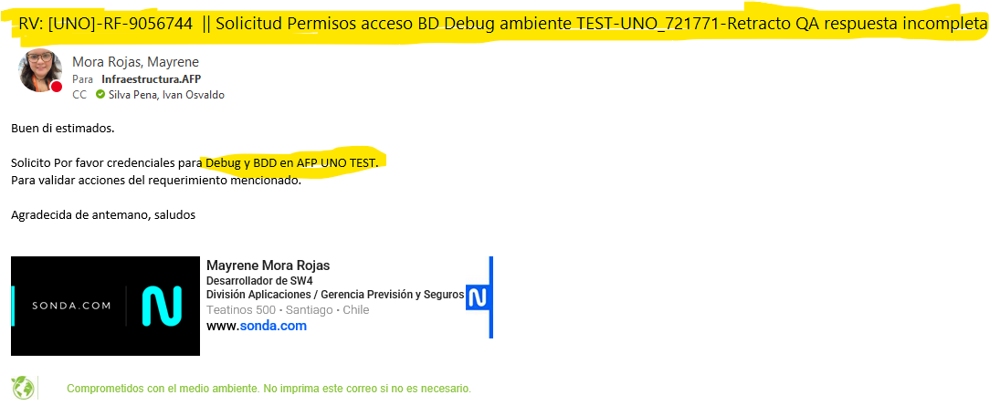

# Conexiones a Base de datos Oracle 🗄️

## Desarrollo local
- Conectarse a la bd DESACAP, es la unica que tenemos disponible solo con vpn Sonda.
- Descargar DBeaver
- Tener el archivo 'tnsnames.ora' en el disco C del computador
- DESACAP =
  (DESCRIPTION =
    (ADDRESS_LIST =
      (ADDRESS = (PROTOCOL = TCP)(HOST = 10.165.202.30) (PORT = 1521))
    )
      (CONNECT_DATA =
        (SERVER = dedicated)
        (SERVICE_NAME = DESACAP)
      )
  ) 
usuario y clave: newafp

## TEST 
- Para Plan vital , Uno y Modelo , se debe solicitar a infra la conexión a la base de datos en test, la cual tendra acceso hasta el dia viernes. se adjunta correo de ejemplo.

### Plan Vital
### UNO
- Ingresar al pivote y crear conexion en SQL DEVELOPER
- Infra entrega las claves de ingreso caducadas, asi que se debe reestablecer la contraseña primero para luego ingresar a la bd.
- Nombre bd : UNO-TEST-UPGRADE (10.188.84.105:1521 DBAFP)
- Usuario y contraseña
- Tipo de conexion: TNS
- Pestaña 'Detalles' selecciones 'Alias de la red' UNO-TEST-UPGRADE
- Al lograr la conexion para poder ver las tablas y packages se debe ir a 'usuarios' y luego a 'newafp' , alli estara disponible la información.

### Modelo
- Ingresar al pivote y crear conexion en SQL DEVELOPER
- Infra entrega las claves de ingreso caducadas, asi que se debe reestablecer la contraseña primero para luego ingresar a la bd.
- Nombre bd : MODELO-TEST (10.166.123.60:1521 DBAFP)
- Usuario y contraseña
- Tipo de conexion: Basico
- Pestaña 'Detalles'
- Nombre host: 10.166.123.60: 1521
- Nombre del servicio: DBAFP
- Al lograr la conexion para poder ver las tablas y packages se debe ir a 'usuarios' y luego a 'newafp' , alli estara disponible la información.

### Capital
- Existe un nuevo pivote para ingresar a bd Capital a traves de Beyond Trust
- Ir a : https://bt-app-scl-01.sonda.com/webconsole/#!/login
- opcion Cuentas vinculadas
- Seleccionar la ip 175.25.129.96
- Click en boton naranjo 'Start RDP Session' , esto descargara un ejecutable en el computador
- Abrir ese ejecutable se enviara una alerta al duo del telefono enrolado ,al aceptar estas dentro del pivote nuevo de capital.
- Aqui dentro entrar a esta ruta: This PC -> Local Disk (C:) -> Program Files -> dbeaver-portable 
- Copiar la carpeta APP que esta lli dentro en nuestro escritorio
- Desde nuestro escritorio ejecutar el dbeaver
- Tipo de conexion: basic
- host: 10.9.34.225 :1521
- dataBase: TEST.sura.cl
- Service name
- Autenticacion: Oracle Database Native
- Credenciales entrefgadas por capital.

## Producción

### Capital
### Plan Vital
### UNO
### Modelo
- Solicitar ingreso a bd ambiente produccion , ejemplo de correo:
- '''Enviado el: jueves, 13 de agosto de 2026 11:12
Para: Infraestructura.AFP <INFRAESTRUCTURA.AFP@sonda.com>; Villegas Contreras, Alex Victor <Alex.Villegas@sonda.com>
CC: Sepulveda Aravena, Cristian Andres <Cristian.Sepulveda@sonda.com>
Asunto: [MODELO] NCG-311 RF-8660355|| Solicitud permisos acceso BD <Solo Lectura> ambiente PRODUCCION

Estimado Alex,
 
Junto con saludar y esperando que te encuentres bien, solicito por favor acceso solo lectura a BD ambiente PRODUCCION de MODELO 
Motivo: Revisión de datos asociados al requerimiento RF- 8660355

Usuario: SNDPMACHUCA

Muchas gracias por su atención.
 
Saludos cordiales.'''

