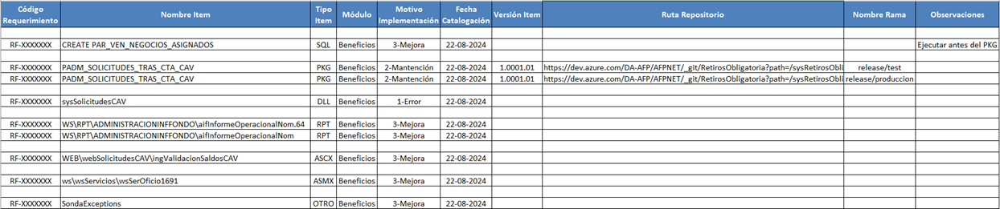
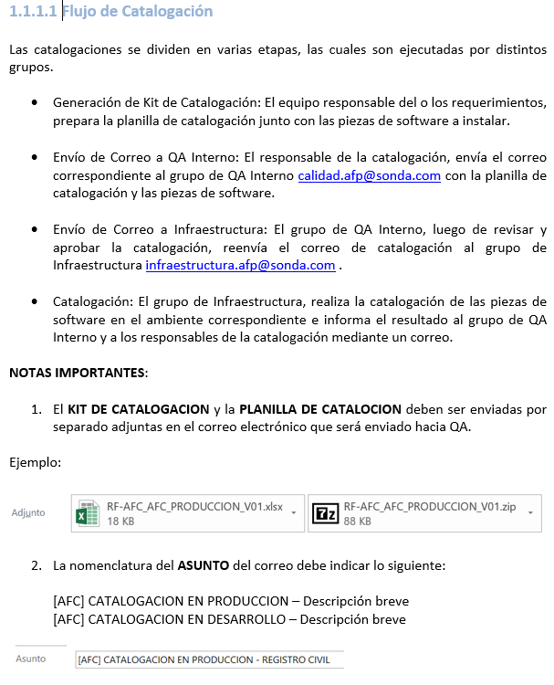
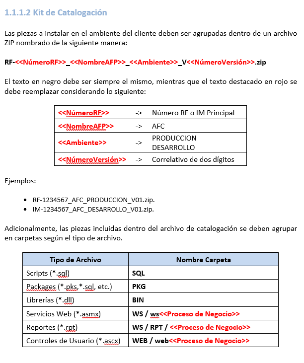
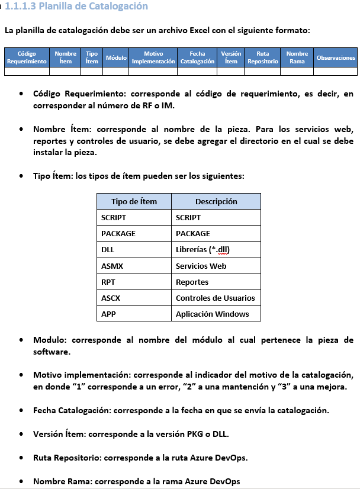
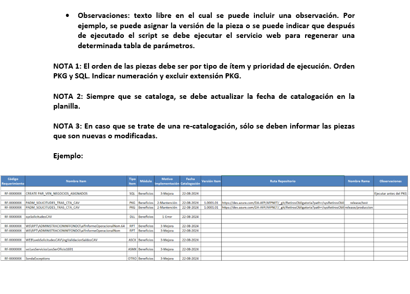

# Documentacion oficial de equipo de Infraestructura

## Flujo catalogación
Las catalogaciones se dividen en varias etapas, las cuales son ejecutadas por distintos grupos.

- Generación de Kit de Catalogación: El equipo responsable del o los requerimientos, prepara la planilla de catalogación junto con las piezas de software a instalar.

- Envío de Correo a QA Interno: El responsable de la catalogación, envía el correo correspondiente al grupo de QA Interno calidad.afp@sonda.com con la planilla de catalogación y las piezas de software.

- Envío de Correo a Infraestructura: El grupo de QA Interno, luego de revisar y aprobar la catalogación, reenvía el correo de catalogación al grupo de Infraestructura infraestructura.afp@sonda.com .

- Catalogación: El grupo de Infraestructura, realiza la catalogación de las piezas de software en el ambiente correspondiente e informa el resultado al grupo de QA Interno y a los responsables de la catalogación mediante un correo.

NOTAS IMPORTANTES: 

- El KIT DE CATALOGACION y la PLANILLA DE CATALOCION deben ser enviadas por separado adjuntas en el correo electrónico que será enviado hacia QA.

Ejemplo: 'RF-AFC_AFC_PRODUCCION_V01.xlsx' /  'RF-AFC_AFC_PRODUCCION_V01.zip'

- La nomenclatura del ASUNTO del correo debe indicar lo siguiente: 

[AFC] CATALOGACION EN PRODUCCION – Descripción breve
[AFC] CATALOGACION EN DESARROLLO – Descripción breve

Ejemplo: [AFC] CATALOGACION EN PRODUCCION - REGISTRO CIVIL 

## Planilla de Catalogación
La planilla de catalogación debe ser un archivo Excel con el siguiente formato:

Código Requerimiento	Nombre Ítem	Tipo Ítem	Módulo	Motivo Implementación	Fecha Catalogación	Versión Ítem	Ruta Repositorio	Nombre Rama	Observaciones
 	 	 	 	 	 	 	 	 	 

- Código Requerimiento: corresponde al código de requerimiento, es decir, en corresponder al número de RF o IM.

- Nombre Ítem: corresponde al nombre de la pieza. Para los servicios web, reportes y controles de usuario, se debe agregar el directorio en el cual se debe instalar la pieza.

- Tipo Ítem: los tipos de ítem pueden ser los siguientes:

Tipo de Ítem	Descripción
SCRIPT	         SCRIPT
PACKAGE   	     PACKAGE
DLL	             Librerías (*.dll)
ASMX	         Servicios Web
RPT	             Reportes
ASCX	         Controles de Usuarios
APP	             Aplicación Windows

- Modulo: corresponde al nombre del módulo al cual pertenece la pieza de software. 

- Motivo implementación: corresponde al indicador del motivo de la catalogación, en donde “1” corresponde a un error, “2” a una mantención y “3” a una mejora.

- Fecha Catalogación: corresponde a la fecha en que se envía la catalogación.

- Versión Ítem: corresponde a la versión PKG o DLL.

- Ruta Repositorio: corresponde a la ruta Azure DevOps.

- Nombre Rama: corresponde a la rama Azure DevOps

## Kit de Catalogación
Las piezas a instalar en el ambiente del cliente deben ser agrupadas dentro de un archivo ZIP nombrado de la siguiente manera:

RF-<<NúmeroRF>>_<<NombreAFP>>_<<Ambiente>>_V<<NúmeroVersión>>.zip

El texto en negro debe ser siempre el mismo, mientras que el texto destacado en rojo se debe reemplazar considerando lo siguiente:

<<NúmeroRF>>	->	Número RF o IM Principal
<<NombreAFP>>	->	AFC
<<Ambiente>>	->	PRODUCCION 
DESARROLLO
<<NúmeroVersión>>	->	Correlativo de dos dígitos

Ejemplos:

- RF-1234567_AFC_PRODUCCION_V01.zip.
- IM-1234567_AFC_DESARROLLO_V01.zip.

Adicionalmente, las piezas incluidas dentro del archivo de catalogación se deben agrupar en carpetas según el tipo de archivo.

Tipo de Archivo	Nombre Carpeta
Scripts (*.sql)	SQL
Packages (*.pks,*.sql, etc.)	PKG
Librerías (*.dll)	BIN
Servicios Web (*.asmx)	WS / ws<<Proceso de Negocio>>
Reportes (*.rpt)	WS / RPT / <<Proceso de Negocio>>
Controles de Usuario (*.ascx)	WEB / web<<Proceso de Negocio>>

- Observaciones: texto libre en el cual se puede incluir una observación. Por ejemplo, se puede asignar la versión de la pieza o se puede indicar que después de ejecutado el script se debe ejecutar el servicio web para regenerar una determinada tabla de parámetros.

NOTA 1: El orden de las piezas debe ser por tipo de ítem y prioridad de ejecución. Orden PKG y SQL. Indicar numeración y excluir extensión PKG.

NOTA 2: Siempre que se cataloga, se debe actualizar la fecha de catalogación en la planilla.

NOTA 3: En caso que se trate de una re-catalogación, sólo se deben informar las piezas que son nuevas o modificadas.

Ejemplo:

## Documento en imagen

