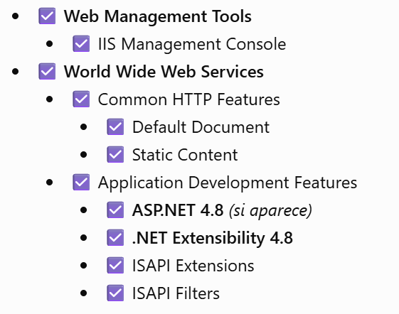
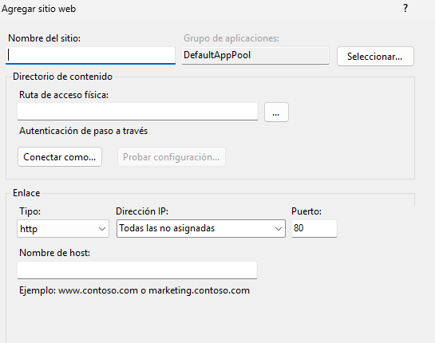

# Configuración del IIS 🧑‍💻
## Requisitos

- Tener permiso de administrador en el computados
- Tener instalado Hosting Bundle de la version del proyecto

## Instalación del Internet Information Services (IIS)

- Presiona Windows + R.
- Escribe: optionalfeatures 
- Presiona Enter.
- Se abrirá Características de Windows.
- Busca y marca: Internet Information Services
- Expande IIS y verifica que estén seleccionados al menos:  




- Presiona Aceptar.
- Windows instalará IIS. Puede pedirte reiniciar.

## Ejecución

- Presiona Windows + R.
- inetmgr
- Administrador de Internet Information Services

- verifica que tu proyecto funciona, Desde la carpeta donde está el .csproj ejecuta dotnet run  (ejemplo respuesta: Now listening on: http://localhost:5000)
- Publica tu api , click derecho sobre la carpeta con icono de 🌍 , y 'publish'
- Crear el sitio en IIS
- Sites → clic derecho → Add Website...
- Site name: nombre identificador para la api
- ruta acceso fisico: escoger el pusblish que acaba de generar
- tipo: http
- IP: 'todas las no asignadas'
- puerto: 8080
- nombre del host: dejar vacio



- Ir a grupos de aplicaciones
- click derecho sobre tu aplicacion:

.NET CLR Version: No Managed Code
Managed pipeline mode: Integrated

- Click sobre tu sitio
- Inicia
- Examinar en puerto 8080
- Si es un swagger, agregar a la url la palabra swagger:  http://localhost:8080/swagger/index.html

<!-- ### .NET

Verificar la versión instalada:

```bash
dotnet --version -->