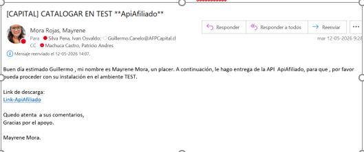
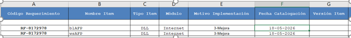
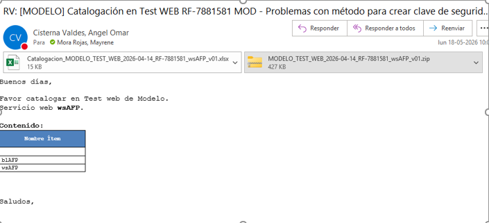

# Catalogaciones 🚀

## Importante

-  En el asunto del correo que se envia a calida se debe agregar la palabra WEB , segun lo que se va a catalogar, ejemplo:
- Con palabra WEB: si envias api 
- Sin WEB: cuando envias a catalogar base de datos , bash , DLL
- Ejemplo: [UNO]-RF-9056744-Retracto QA respuesta incompleta- CATALOGAR EN TEST WEB **apiCambioDistribucionDeFondos**

## Ambiente TEST

- En general . para enviar a catalogar a TEST , se debe enviar el correo a calidad.AFP con copia ivan o a quien este involucrado.
- En el caso de ser API se debe adjuntar el zip del publish de la api completa y el archivo excel.
- En caso de ser DLL o package se debe incluir la pieza en una carpeta con este nombre (cambiando los datos a los correspondientes), ejemplo: RF-9103333 Catalogacion UNO TEST- relacion afiliado y empleadora TEX-12-08-2026, dentro, carpETAS:
- PKG: piezas de package
- BIN: aqui van las DLL's correspondientes

### Catalogacion Capital api Migración
- Compilar solución
- Generar compilado de la api: click derecho en archivo del nombre entero de la api con icono de circulo azul ~ click en publicar ~ escoger carpeta donde se guarda el compilado ~ aceptar y publicar.
- Ese compilado se convierte a zip y se aloja en el drive el cual ya tiene los permisos para Guillermo canelo: https://sondachile-my.sharepoint.com/my?id=%2Fpersonal%2Fmmorar%5Fsonda%5Fcom%2FDocuments%2FCatalogaciones%2Dcapital&viewid=7491ab5b%2Ddd44%2D44a3%2Dbc25%2De67e3481f1c4
- seguir la estructura del mensaje de envio de api para Guillermo.

- Importante, es un zip y un correo por api a catalogar.

### Catalogacion Capital DLL
- Luego de haber mergeado el PR con la solución del ticket, moverte a la rama reléase/test , actualizar , y recién allí compilar para sacar la DLL correspondiente.
- Ubicar ticket en aranda correspondiente a tarea que se esta ejecutando.
- Compilar solucion
- Ubicar DLL que se va a mandar a catalogay convertir en zip
- Adjuntar dicho zip en el ticket de aranda
- Dejar mensaje, donde se indique es para catalogar en el ambiente TEST/PRODUCCION, etc
- Cambiar el estado del ticket a ‘Pendiente certificacion’
- Enviar por correo a Guillermo el aviso sobre dicho ticket que esta pendiente por catalogación de DLL.

### Catalogacion Modelo DLL
- Luego de haber mergeado el PR con la solución del ticket, moverte a la rama reléase/test , actualizar , y recién allí compilar para sacar la DLL correspondiente.
- Ir a deploy/modelo y actualizar archivo Excel : Catalogacion_MODELO_TEST_WEB_2026-05-18_RF-8172978_wsAFP_v01. Hay que editarlo con el ambiente donde se enviara a catalogar, fecha y numero de ticket aranda.
- dentro de planilla se cambian todos los ítems necesario.

- Editar carpeta comprimida: MODELO_TEST_WEB_2026-05-18_RF-8172978_wsAFP_v01 de la misma manera que el archivo , Excel. Estar pendiente con los nombres de las carpetas que arman la ruta a los archivo.
- Aquí se adjuntan las DLLs, siempre adjuntar la DLL del cambio y además hay otra que es la visual (preguntar cual es).
- mantener esta estructura de correo: desde el titulo , al saludos

- Correos de ejemplo son del 18-05-2026
- Despues que se catalogue en TEST hay que tomar las evidencia en dicho ambiente , formar una ftu y enviar esa ftu a la persona dueña del ticket con copia  pmo , a ivan y a patricio machuca.
- adjuntar esa ftu en el ticket de aranda y cambiar el estado a pendiente certificación.

### Catalogacion en BD  (agregar columa a tabla/creacion de tabla)
- Para agregar una columna en alguna tabla, en ambiente test , de debe enviar ell scrip mediante catalogacion para ser ejecutado por ellos de la siguiente manera:

- Se debe crear con la planilla excel de catalogacion y adjunto el zip como de costumbre.
- En la planilla excel hay que dejar el campo SQL, con el nombre del archivo .sql que tendra referencia a la tabla que se creara o se editara.
- En el zip  hay que dejar la carpeta SQL con el script dentro que ejecutaran los de infra.
- Se envia a calidad para que pase por los filtros.
- importante, en la planilla de excel se debe declarar los scripts en orden de ejecucion.

## Ambiente Producción
- Hay que tomar la rama con la que se trabajo y se hizo el PR  a reléase/test y volver  a hacerla push y con esa rama armar el pr  arelease/produccion
### Capital producción
- En el caso de capital , ellos mismo se encargan de hacer la catalogacion en sus distintos ambiente
### Demas AFP's
- Se debe enviar el mismo correo que se envio para catalogar en TEST, solo cambiando en el asusto y nombres de carpetas la palabra TEST a PRODUCCION y agregar al envio de corre a PMO de la AFP involucradas, ademas se debe adjuntar el print de panatalla donde se dio el OK para el paso a produccion.